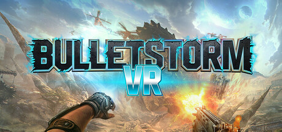

**Bulletstorm is the imaginative FPS where every kill earns Skillshots for creative murder using a leash, drop kick, and charged weapon shots. Higher skillshot variety and quality earns more points to spend on upgrades, rewarding creative slaughter.**

---

## 📖 About

Bulletstorm is the imaginative FPS where every kill earns Skillshots for creative murder using a leash, drop kick, and charged weapon shots. Higher skillshot variety and quality earns more points to spend on upgrades, rewarding creative slaughter.

## ⚠️ Problems Without Trainer

| Problem | Status |
|---------|--------|
| **Skillshot Discovery** — Finding all 135 skillshots requires experimenting with all weapons and enemies | ✅ Solved |
| **Echo Mode** — Getting top scores on all Echo chapters requires near-perfect technique | ✅ Solved |
| **Anarchy Mode** — Cooperative mode requires coordinating skillshots with teammates | ✅ Solved |
| **Ulysses Collectibles** — Finding all audio logs requires thorough level exploration | ✅ Solved |

## ✅ Solution

The **Bulletstorm Trainer** solves all these issues by giving you complete control over the game.

## 🎯 Full Feature List

- Unlimited Resources
- God Mode / Invincibility
- Instant Skill Cooldown
- One-Hit Kill
- Freeze Game Timer
- Unlock All Items & Achievements
- Custom Speed Multiplier
- Save State Anywhere

## 🚀 Quick Start

1. **Disable Windows Defender** temporarily (trainer may trigger false positive)
2. Download the trainer from the button above
3. Launch Bulletstorm
4. Run the trainer as Administrator
5. Activate desired cheats with hotkeys

## 💎 Free vs Paid

| Feature | Free | Pro |
|---------|------|-----|
| Basic God Mode | ✅ | ✅ |
| Unlimited Resources | ✅ | ✅ |
| All Advanced Cheats | ❌ | ✅ |
| Auto-Updates | ❌ | ✅ |
| Priority Support | ❌ | ✅ |

## 💻 Requirements

- Windows 10/11 (64-bit)
- Bulletstorm (any version)
- .NET Framework 4.8+
- DirectX 11+

## 🍎 macOS

macOS users can use our alternative tool:

## ⚖️ Legal

This trainer is for educational and single-player use only. Use responsibly.

---

